# 🐡 Puffy: Deep Sea Adventure

A one-button hyper-casual web game (HTML5 + Canvas, no build step, no asset files) with an **SDK adapter** for Poki, CrazyGames, YouTube Playables and Facebook Instant Games. The game is English only.

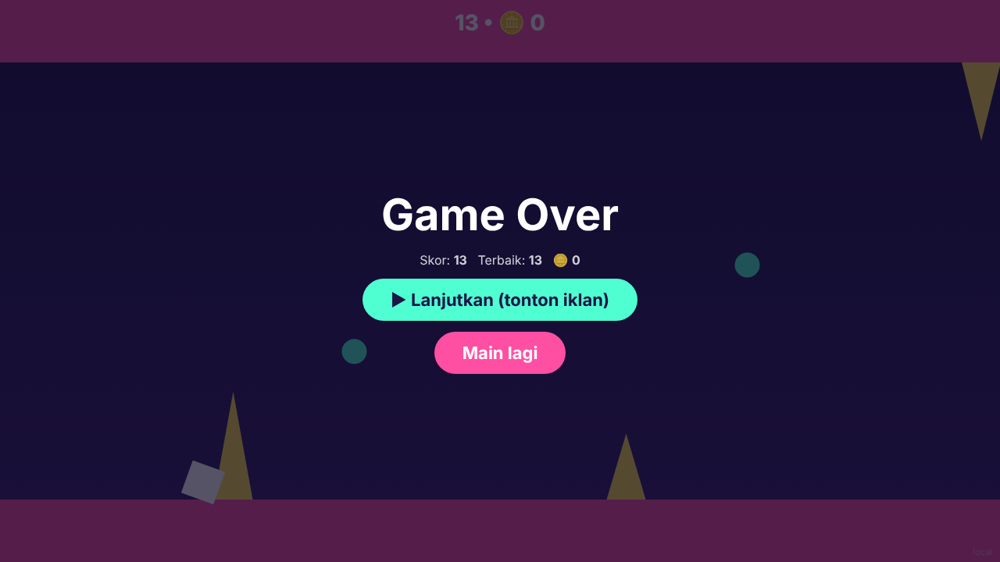

## Concept
Puffy the pufferfish dives deeper and deeper. **Tap / click / Space**: Puffy **puffs up** (floats up) or **deflates** (sinks down). The score is the **depth (m)**.

| Zone | Depth | Hazards |
|---|---|---|
| 🌤️ Shallow Waters | 0–300 m | Sea urchins, sharp coral, icicles |
| 🌊 Open Sea | 300–800 m | + Electric jellyfish, fishing hooks |
| 🌑 Twilight Zone | 800–1500 m | + Swordfish (announced by a "!" sign), nets, plastic trash |
| ✨ Midnight Zone | 1500 m+ | Everything, more densely; a dark sea lit only around Puffy |

- **Trenches**: the floor/ceiling disappears. Falling in means game over, so switch sides before a trench.
- Sea colour, terrain and music (increasingly muffled) change with depth.

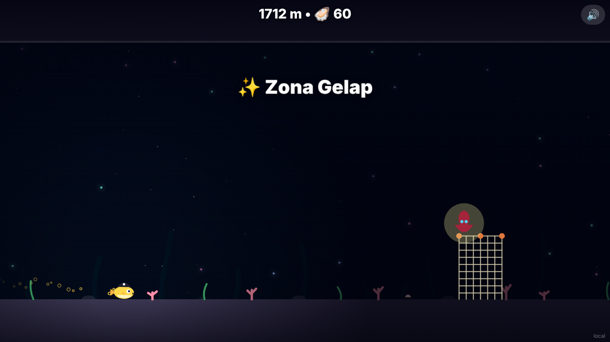

## ⚖️ The two modes & the pearl economy
One pearl purse for everything, spent on buying characters.

| | ♾️ Free Dive — *explore the sea* | 🗺️ Adventure — *beat the challenges* |
|---|---|---|
| Collected pearls | Go straight into the purse | Count towards ★★, paid out through **new-star bonuses** (can't be farmed by replaying a level) |
| 📖 Encyclopedia creatures | ✅ Only here | ❌ |
| Rare moments | ✅ +5 🦪 | Still shown, no reward |
| Depth record / stars & bosses | Record | Stars & bosses |
| Daily missions & streak | ✅ | ✅ |

Character prices are tuned so the last character is a goal of roughly 1–2 weeks of regular play (about 350–450 🦪/day from diving, missions and streaks). The **+40 🦪** ad button is limited to **5× per day**.

## 🗺️ Adventure mode (levels)
Besides **♾️ Free Dive** (endless) there are **20 levels** (5 per zone) with a **FINISH** line and a progress bar.
- Every level has a **fixed layout** (seeded), so it can be memorised and replayed for more stars.
- The 5th level of each zone is an **Exam** (longer and harder, purple button).
- ★ reach the finish · ★★ + collect ≥70% of the pearls · ★★★ + no defeat, i.e. don't use "Continue" (a popped shield doesn't cost a star).
- Pearl reward for every new star (10 + 2×level number). The next level unlocks once the previous one is complete.
- **A boss on every Exam level** (`src/bosses.js`): it can't be fought, the goal is to **survive until the 🏁**. Each attack targets the **top or bottom lane**; that lane **flashes red** first (~1 s) → switch to the other side!

  | Level | Boss | Attack |
  |---|---|---|
  | 5 | 🦀 Giant Crab | A giant claw sweeps in from the right |
  | 10 | 🦈 Hammerhead Shark | Charges from behind |
  | 15 | 🐙 Giant Octopus | Tentacles burst from the top/bottom just ahead (marked by bubbles) |
  | 20 | 🎣 Giant Anglerfish | Lunges from behind with its jaws wide open |

  Attacks get more frequent near the finish. Regular obstacles are reduced on Exam levels so the boss is the main challenge.

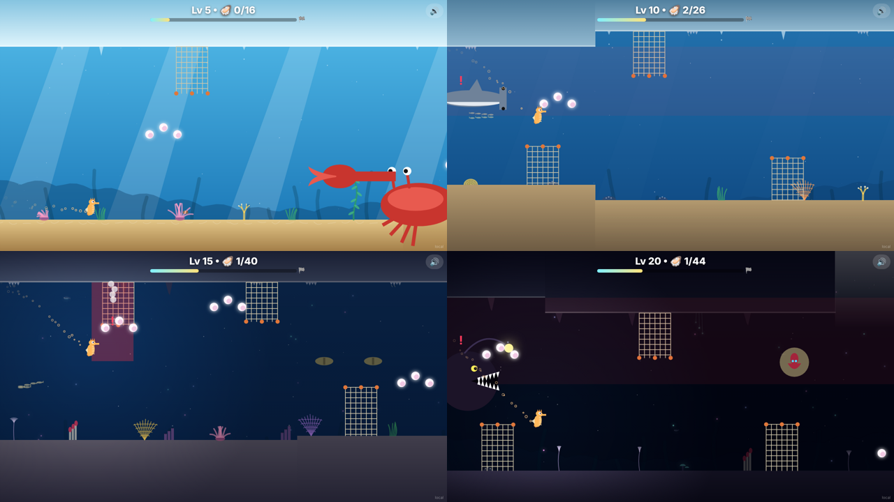

- **Pearl patterns follow the level's position within its zone** (tier 0–4): the first level of each zone (1, 6, 11, 16) only has straight lines / simple low-high rows, then hills & valleys, diagonals, waves, up to tight zig-zags on the Exam level. Every zone starts easy again. In Free Dive the tier follows how far you are into the zone.
- Level data lives in `src/levels.js`. Quick test of the results screen: `?finish=25` (every level becomes 25 m).

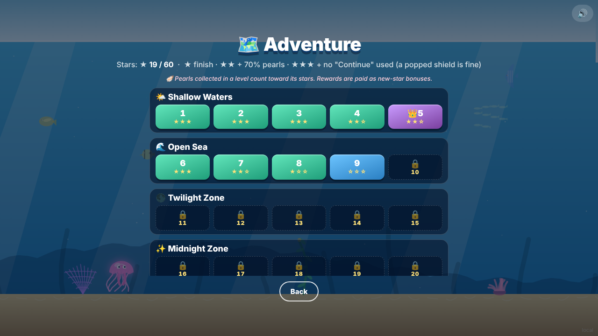

## A living sea backdrop
Principle: **the background supports, it doesn't compete.** Decorations are sparse and slightly transparent, the start of a run is deliberately calm, so hazards, pearls and the character always stand out.

- **Background fish** (`src/ambient.js`) per zone on several parallax layers: tangs, butterflyfish, angelfish, wrasse, sardine schools, turtles, rays, barracuda, silver hatchetfish, glowing lanternfish, squid, glowing siphonophores and giant anglerfish silhouettes. Tails flap; they are intentionally few, small and faint so they don't distract from hazards & pearls.
- **Seabed** (`src/decor.js`): swaying kelp, seagrass, branching coral with pulsing polyps, brain coral, sea fans, anemones (with clownfish that **hide** when Puffy passes), starfish, giant clams that **close** when approached, sponges, **tube worms that retreat into their tubes**, sea lilies, glowing mushrooms and smoking hydrothermal vents.
- **Ceiling**: icicles & water drops (shallow), barnacles that stretch out their legs, stalactites and glowing worm threads (deep).
- **Far scenery**: reef ridges, shipwreck silhouettes and light caustics on the shallow sand.

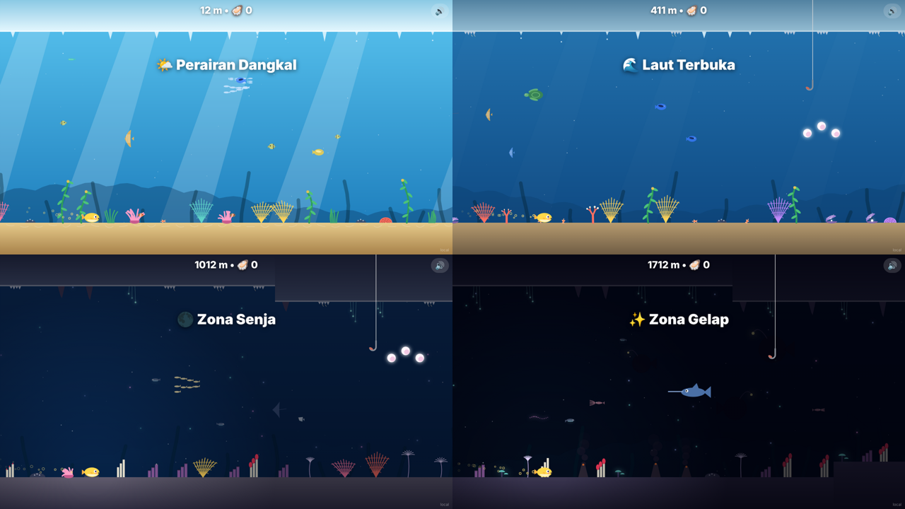

## ✨ Rare moments
Every so often (about every 40–75 seconds) a big event happens in the background, depending on the zone. Watch it to the end for **+5 🦪** (there's also a "Witness 2 rare moments" mission). Code: `src/moments.js`, test with `?moment=humpback`.

| Moment | Zone |
|---|---|
| 🐬 A pod of dolphins leaping | Shallow |
| 🌀 A swirl of thousands of small fish (*bait ball*) | Shallow, Open |
| 🐋 A humpback whale passes with long fins & whale song | Shallow, Open |
| 🐳 A sperm whale dives into the depths | Open, Twilight |
| 🦑 A giant squid with long tentacles | Twilight, Midnight |
| 🪼 A giant glowing jellyfish rises from the abyss | Midnight |
| ✨ A wave of bioluminescent light | Twilight, Midnight |

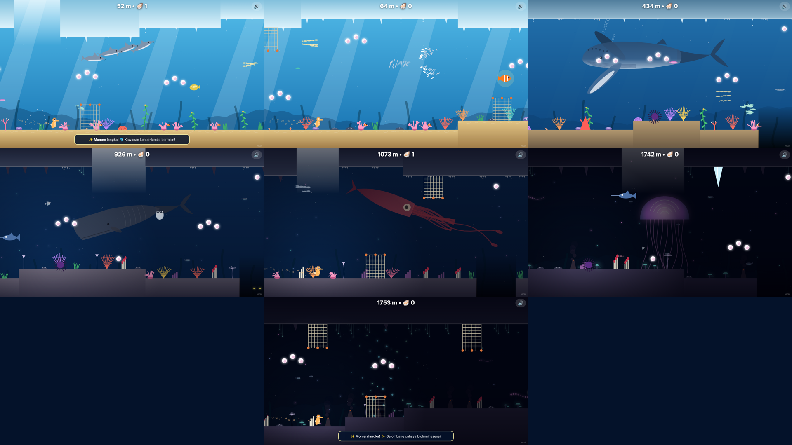

## Defeat animations
Every hazard has its own animation & sound before the Game Over screen, plus a line naming the cause (`src/deaths.js`):

| Hazard | Animation |
|---|---|
| 🦔 Sea urchin / 🪸 coral / ❄️ icicle | Pricked: flashes red, leaks air & zig-zags away like a deflating balloon |
| 🪼 Electric jellyfish | Zapped: shakes, flashes white-yellow with lightning, then gets scorched and smoky |
| 🎣 Fishing hook | Caught by the mouth and reeled off the top of the screen |
| 🕸️ Net | The net wraps around, the character struggles, then is hauled up |
| 🗡️ Swordfish | Impact stars, knocked back spinning with dizzy stars |
| 🛍️ Plastic trash | Wrapped in a plastic bag and drifts away helpless |
| 🧱 Wall | "Thud": squashed flat, dizzy stars, then slides down |
| 🕳️ Bottom trench | Spirals smaller into the dark, yellow-eyed jaws snap shut |
| ☀️ Top trench | Flung out of the water with a splash |

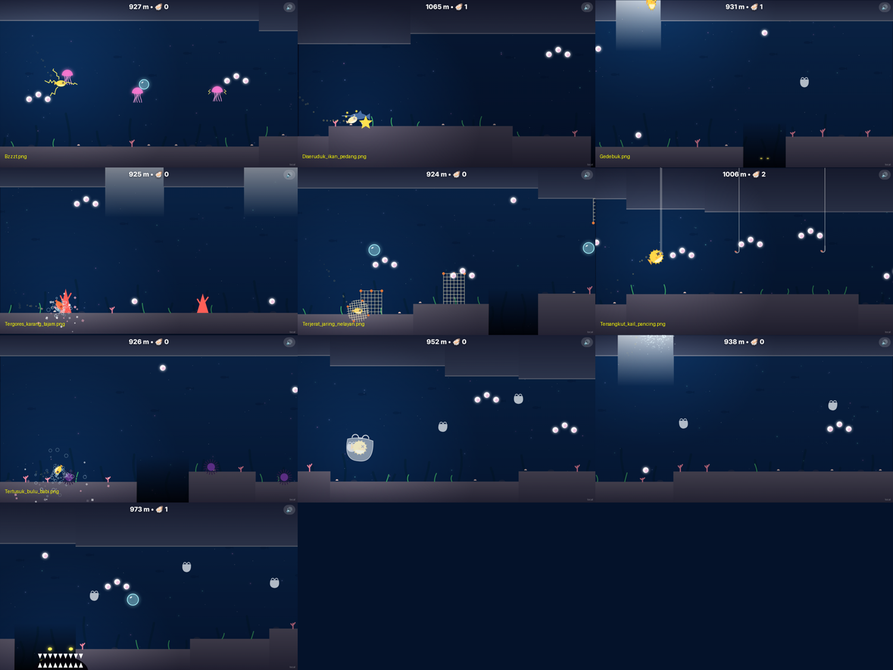

## 🎯 Daily missions
Every day brings 3 new missions (2 silly + 1 regular, the same for the whole day) with pearl rewards. Claim normally or **×2 with a rewarded ad**. The 🎯 Missions button shows a badge with the number of rewards ready to collect.

- 😜 Silly: get zapped by jellyfish 3×, get caught on a hook, wrapped in plastic, tangled in a net, rammed by a swordfish, become a trench monster's snack, get launched out of the water, thud into a wall, get popped by spikes, get knocked out before 50 m, puff up/deflate 100× in one dive.
- Regular: collect 50 pearls, reach 500 m, use abilities 5×, meet 3 rare creatures, pop 2 shields, dive with 2 different characters.

The mission list is in `src/missions.js` (just add a new object to `POOL`).

### 🔥 Daily streak
Complete **all three** of today's missions → streak +1 (if yesterday was also completed) and earn a **streak bonus**. Miss a day → the streak resets to 0.

| Day | 1 | 2 | 3 | 4 | 5 | 6 | 7 🎁 |
|---|---|---|---|---|---|---|---|
| Bonus 🦪 | 20 | 30 | 40 | 50 | 60 | 80 | 150 |

The 7-day cycle repeats. The bonus can be claimed normally or ×2 with a rewarded ad.

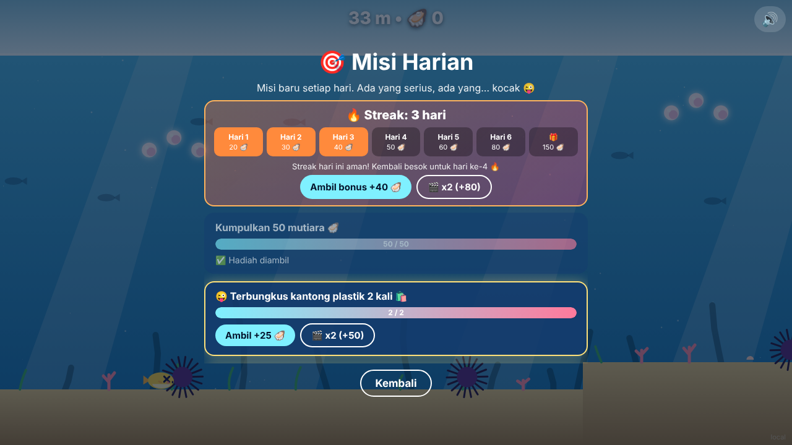

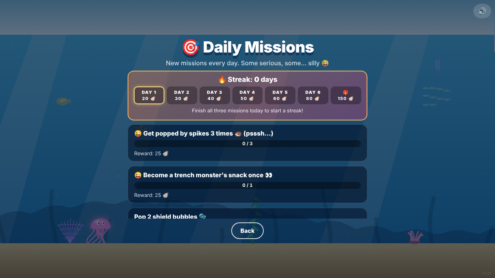

## Collectibles
- 🦪 **Pearls**: the currency for unlocking **new sea characters** (see below).
- 📖 Rare Encyclopedia creatures only appear in **♾️ Free Dive**.
- 🫧 **Shield bubble**: immune to one collision/fall. Appears rarely, or from the "Start with a shield" rewarded ad.
- 📖 **Sea Encyclopedia**: 8 rare creatures (2 per zone). Touch one to discover it and read its facts.

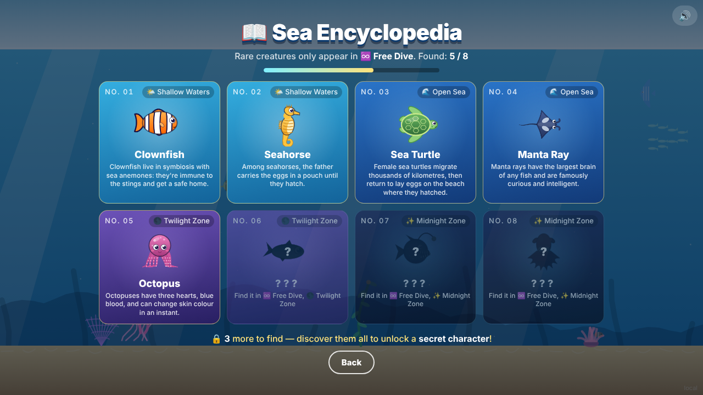

## Sea characters
Each character floats & sinks in its own way. The pricier, the more unique its mechanics and the more complex its animation.

| Character | Price | Movement | Animation |
|---|---|---|---|
| 🐡 Puffy (Pufferfish) | Free | Tap: puff up (rise) ↔ deflate (sink) | Spikes appear when puffed up, fins flap |
| 🐴 Kudi (Seahorse) | 🦪 150 | Like Puffy but slower & slimmer | Tail curls when sinking, dorsal fin flutters |
| 🪼 Jeli (Jellyfish) | 🦪 400 | Tap = an upward pulse, otherwise it sinks | Bell contracts, tentacles trail behind the motion |
| 🐙 Okto (Octopus) | 🦪 900 | Ink jet: switches sides super fast + briefly invulnerable | Tentacles stream while jetting, skin changes colour, ink cloud |
| 🦈 Mantra (Manta Ray) | 🦪 1600 | Glides in zig-zags at a steady speed, can turn mid-water | Wings flap, tail whips, body tilts |
| 🎣 Lumi (Anglerfish) | 🦪 2500 | Like Puffy + a lantern that lights the dark sea & attracts pearls | Springy lure, mouth opens when a pearl is near, glowing spots |

### 🗡️ Active skills (Free Dive)
The round **⚡ button at the bottom right** (or the **X** key). After use the button recharges (cooldown) and shows a countdown. Not available in Adventure — there the bosses are still beaten by surviving until the 🏁.

| Character | Skill | Effect | Cooldown |
|---|---|---|---|
| 🐡 Puffy | 🦔 Spike Burst | Spikes fly in every direction, popping nearby hazards | 12 s |
| 🐴 Kudi | 🌀 Tail Whirl | Pulls in every pearl on screen, blows away nearby jellyfish & plastic | 12 s |
| 🪼 Jeli | ⚡ Shock Wave | An electric wave forward destroys hazards in its path | 14 s |
| 🐙 Okto | 🐙 Octo Arms | Tentacles grab and fling up to 3 nearest hazards ahead | 12 s |
| 🦈 Mantra | 💨 Wing Charge | Charges for 2 s: invulnerable and smashing through every hazard hit | 15 s |
| 🎣 Lumi | 🔦 Lantern Flash | Freezes every hazard on screen for 3 s | 18 s |
| 🐋 Bubu | 🌊 Whale Spout | Washes every hazard off the screen | 20 s |

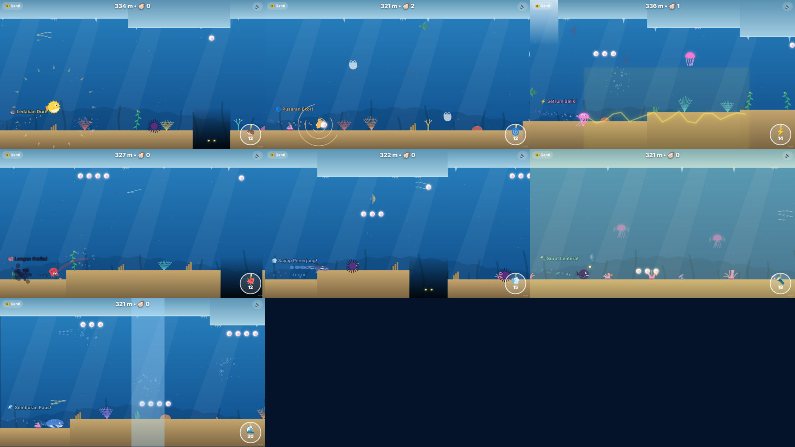

### 🔄 Swap characters mid-dive (Free Dive)
The **🐠 Swap** button (top left, or the **C** key) pauses the game and shows the characters you own with their abilities. After swapping: 1 s of invulnerability, then an 8 s wait before you can swap again. Not available in Adventure.

### ⚡ Special abilities (hazard-related)
| Character | Ability |
|---|---|
| 🐡 Puffy | When puffed up, **swordfish bounce off** its spikes |
| 🐴 Kudi | Slim body: **slips through nets** |
| 🪼 Jeli | **Immune to electric jellyfish** (they're family) |
| 🐙 Okto | Ink **blinds swordfish** & **freezes nearby jellyfish** |
| 🦈 Mantra | Slippery and flat: **fishing hooks miss** |
| 🎣 Lumi | Catches **plastic trash** to bin it: clean sea +2 🦪 |

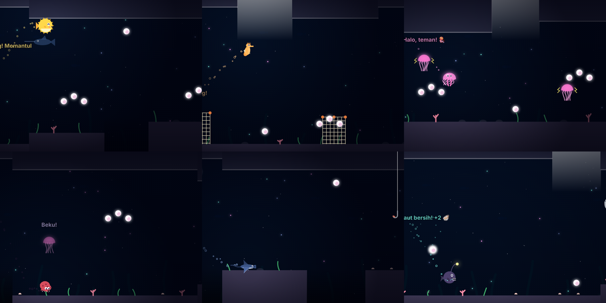

### 🐋 Secret character: Bubu the Mini Blue Whale
Unlocked **for free** once all 8 creatures in the 📖 Sea Encyclopedia are discovered. Until then it appears as a "???" silhouette with progress (e.g. 7/8).
- Movement: medium rise/sink, big body; spouts from its blowhole when rising.
- ⚡ **Whale song** every 6 s: a sonar wave that scares off swordfish & hooks and freezes nearby jellyfish.

| Locked | Playing |
|---|---|
| 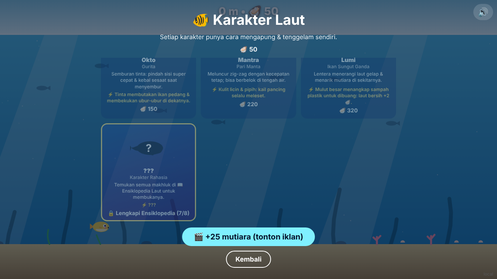 | 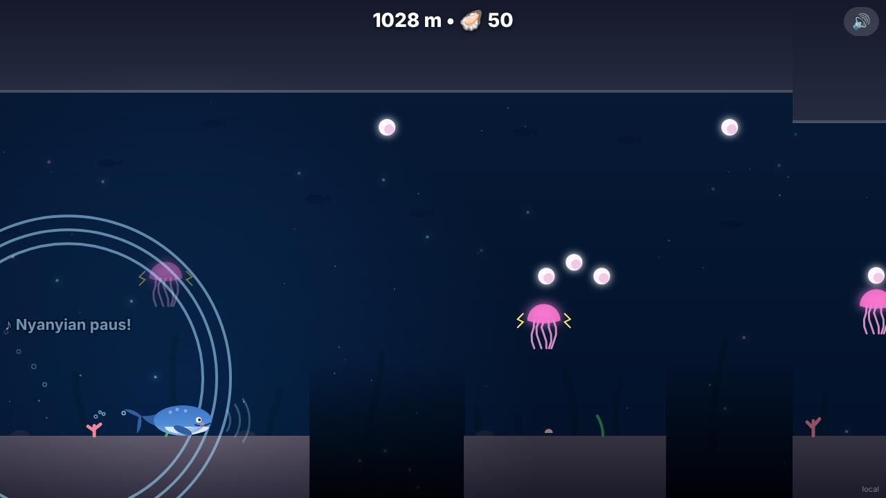 |

Character data (physics, hitbox, abilities, drawing) lives in `src/characters.js`.

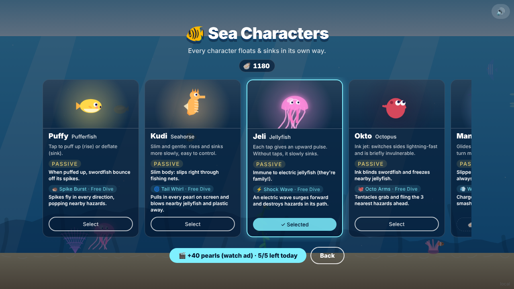

## Monetisation
- Rewarded: continue after a defeat, start with a shield, +40 pearls in the characters menu (max 5×/day), ×2 mission rewards.
- Interstitial: every 3 runs, at least 60 seconds apart.
- Sound & music are muted automatically during ads.
- An ad that errors or never answers is treated as "no reward" after 45 s so the game never freezes (`withAd` in `src/game.js`).

## Running
```bash
python3 -m http.server 8000 --bind 127.0.0.1
# open http://localhost:8000/?platform=local
# test the deep zones: http://localhost:8000/?start=1000
# test abilities: http://localhost:8000/?start=1000&hazard=jelly  (urchin, coral, icicle, jelly, hook, sword, net, bag)
```
`?platform=` can be `poki`, `crazygames`, `youtube`, `facebook` or `local` (simulated ads).

Automated tests (Playwright + Chromium) for the ad flows and the finale are in `tools/tests/`.

## ⚙️ Settings
The **⚙️ Settings** button in the main menu and the pause panel (`src/settings.js`, stored separately from progress):
- 🎵 Music, 🔊 Sound effects, 📳 Vibration — each on/off.
- ✨ Graphics: **Auto** (switches to light if FPS < 45 in the first seconds), **High**, or **Light** (75% resolution, no glow effects, no decorative background layers & background fish).
- 🗑️ Reset all progress (must be pressed twice; settings are kept).

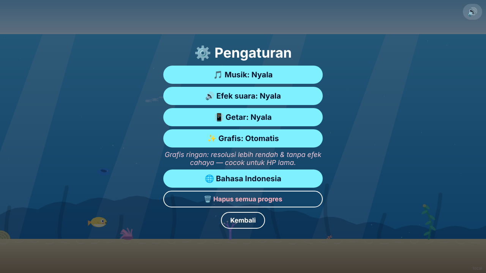

## 🎨 Design system
All screens share one set of CSS tokens at the top of `index.html` (`:root`): colours (`--cyan`, `--gold`, `--pink`, `--surface`, …), radii (`--r-lg/md/sm`) and a type scale:

| Token | Desktop | Short screens | Used for |
|---|---|---|---|
| `--fs-display` | 84px | 46px | Logo only |
| `--fs-h1` | 56px | 32px | Result screens (game over, level complete, finale) |
| `--fs-h2` | 40px | 24px | Screen titles (missions, levels, characters, …) |
| `--fs-card` | 22px | 17px | Big card labels (mode cards, Continue / Dive again) |
| `--fs-h3` | 18px | 14px | Section and card titles |
| `--fs-body` | 16px | 13px | Paragraphs, list items |
| `--fs-small` | 13px | 11px | Secondary lines, notes |
| `--fs-xs` | 12px | 10px | Dense card copy |
| `--fs-micro` | 11px | 9px | Uppercase labels |
| `--fs-btn` / `-sm` / `-xs` | 18 / 15 / 13px | 15 / 13 / 11px | Buttons |

Titles are white, weight 900, with a navy depth shadow (`--title-shadow`); the gradient wordmark is reserved for the logo. Cards use the dark translucent `--surface` with a hairline border. The compact layout only changes the token values, so every page scales together. The shared rules live in the "Design system" block at the end of the stylesheet.

## 🌐 Language
English only. All UI text lives in `src/i18n.js` (`t(key, vars)` for templated UI text, `data-i18n="key"` in the HTML); names, facts and labels are written directly in the data files.

## 🏆 Finale
When **all 20 levels are cleared, all 7 characters are owned (Bubu included) and the Sea Encyclopedia is 8/8**, a finale screen congratulates the player: all characters swimming in a row, plus a summary (levels, stars, characters, creatures, best depth) and a note on how many stars are left for a perfect 60/60 run (`checkFinale` in `src/game.js`).
- It appears **once**, at a calm moment: right after buying the last character, when leaving the level-complete screen, or at the Game Over screen of the dive in which the last creature was found. It never interrupts a run.
- Afterwards a **🏆 Finale** button in the main menu shows it again. A save that was already complete before this feature only gets the button, no surprise screen.
- "Keep diving" returns to the menu; Free Dive, missions and streaks continue as usual.
- Confetti: two cannons at the bottom corners plus a light shower from the top (`startConfetti` in `src/game.js`, own overlay canvas, runs only while the finale is open) and two cannon "pop" sounds (`sfx.confetti` in `src/audio.js`, follows the sound-effects setting). Skipped when the system asks for reduced motion, thinner in Light graphics.
- Tests: `tools/tests/finale.mjs`.

## 🎓 New players
- **Interactive tutorial** in the first Free Dive: (1) the game waits until the player tries tapping up/down, (2) a row of practice pearls, (3) one practice urchin that can't defeat you. Done → "🎉 Great! You're ready to dive!", never shown again.
- **Staged tips** (each shown once): the ⚡ skill, swapping characters 🐠, daily missions, characters you can afford, and an invitation to try Adventure — shown when the feature becomes relevant.

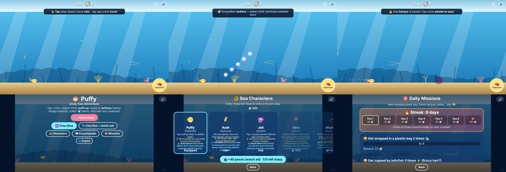

## 📱 Phones
On a phone held upright a "Turn your phone sideways" screen appears (the game pauses automatically). On short screens (landscape phones) every panel uses a compact layout: character cards scroll sideways, panels can be scrolled.

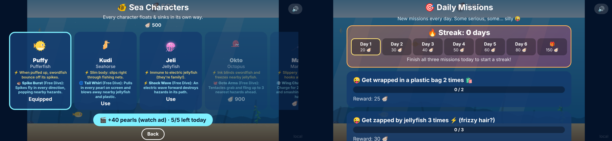

## Developer parameters
`?start=`, `?hazard=`, `?finish=`, `?moment=`, `?debug` **only work on localhost** (`src/dev.js`). On a portal these parameters are ignored so they can't be used to cheat. `?platform=` stays active.

## Controls
Tap/click/Space: rise/sink · **X**: skill (Free Dive) · **C**: swap character (Free Dive) · **P / Esc / ⏸**: pause. Switching tabs pauses the game automatically. On desktop the ⚡, 🐠 and ⏸ buttons show a small key label (X, C, P); it is hidden on touch screens.

## Structure
- `src/game.js`: game flow, Puffy physics, shields, discoveries, UI
- `src/world.js`: terrain, trenches, zones, hazards, pickups, all world rendering
- `src/characters.js`: 6 sea characters + the secret one (movement mode, abilities, animation)
- `src/creatures.js`: Sea Encyclopedia creatures and their facts
- `src/missions.js`: daily missions & rewards
- `src/deaths.js`: per-hazard defeat animations
- `src/particles.js`: bubbles, sparkles, bursts
- `src/audio.js`: synthesised sound effects & music (Web Audio API)
- `src/sdk/adapter.js`: one interface for all platforms

## 📦 Release
- `python3 tools/build.py [platform]` → `release/puffy-<platform>.zip`, ready to upload (the platform is baked in, no URL parameter needed).
- Covers & icon: `release/covers/` (generated by `tools/covers.html` from the game's own art).
- Store page text: `release/STORE_LISTING.md`. CrazyGames checklist: `release/CHECKLIST.md`.

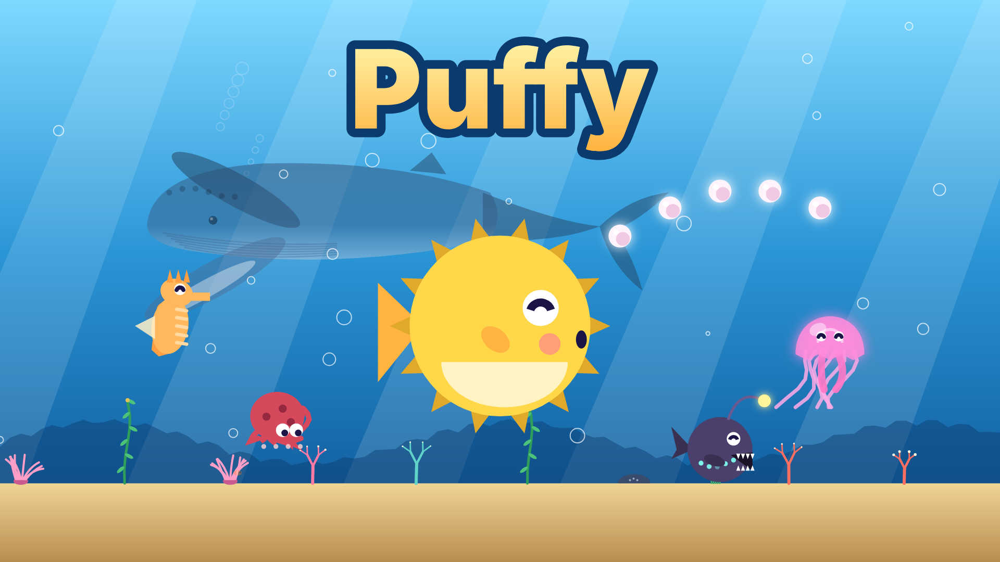

## Before submitting
- Facebook: fill in `FB_INTERSTITIAL_ID` / `FB_REWARDED_ID` in `src/sdk/adapter.js` and add `fbapp-config.json`.
- YouTube Playables: only ads from the YouTube SDK, no in-game purchases.
