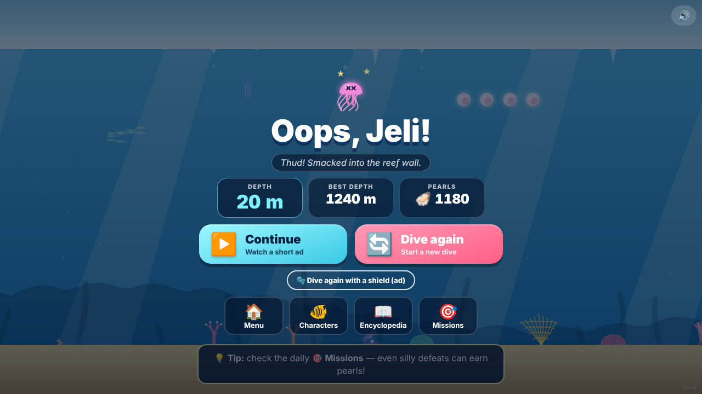

# Game Design Document

*Puffy: Deep Sea Adventure* — non-technical description of the game as it is built today. Numbers in this document come from the code; when you change a value in the code, update it here too.

## 1. Concept

**One-line pitch:** Tap to puff up and dive! Dodge urchins, jellyfish and fishing hooks, collect pearls and discover the creatures of the deep sea.

Puffy the pufferfish swims to the right through a corridor between the seabed and an icy or rocky ceiling. A tap makes Puffy **puff up** and float to the top; the next tap makes Puffy **deflate** and sink to the bottom. The whole game is about choosing the right moment to switch sides. The deeper Puffy goes, the darker the sea, the faster the dive and the more dangerous the hazards.

**Pillars**

1. **One button, readable danger.** Every hazard is visible and telegraphed (a "!" before a swordfish, a red flashing lane before a boss attack). A loss should always feel like the player's own timing.
2. **A living ocean.** Background fish, corals, rare events and a sea encyclopedia with real facts make the world worth exploring, not just surviving.
3. **Something new every session.** Daily missions (some of them silly), a daily streak, characters to unlock and stars to collect give short sessions a goal.
4. **Respect the player.** Ads only at natural breaks, rewarded ads always optional, no purchases, progress saved automatically.

**Audience:** casual players of all ages on web game portals, desktop and mobile. Sessions of a few minutes. No reading required to start playing.

## 2. Controls

| Action | Touch | Keyboard / mouse |
|---|---|---|
| Puff up / deflate (switch sides) | Tap anywhere | Click, Space or ↑ |
| Special skill (Free Dive) | ⚡ round button, bottom right | **X** |
| Swap character (Free Dive) | 🐠 Swap button, top left | **C** |
| Pause | Pause button, top right | **P** or **Esc** |
| Sound on/off | 🔊 button, top right | — |

On desktop the ⚡, 🐠 and pause buttons show a small key label (X, C, P). Switching browser tabs pauses the game automatically. On a phone held upright the game asks the player to rotate to landscape.

## 3. Game modes

| | ♾️ Free Dive | 🗺️ Adventure |
|---|---|---|
| Goal | Dive as deep as possible | Reach the 🏁 finish line of each level |
| Structure | Endless, random layout | 20 fixed levels (5 per zone), same layout every attempt |
| Speed | Starts at 400 px/s and keeps increasing | Fixed per level (higher on later levels) |
| Pearls | Go straight into the purse | Count toward stars; paid out as new-star bonuses |
| Encyclopedia creatures | ✅ Only here | ❌ |
| Rare moments | ✅ +5 🦪 each | Shown, no reward |
| Active skills, character swap | ✅ | ❌ |
| Bosses | ❌ | ✅ on Exam levels 5, 10, 15, 20 |

Free Dive is for exploring and collecting; Adventure is a structured challenge with stars and bosses.

## 4. The ocean: zones and hazards

| Zone | Depth | New hazards |
|---|---|---|
| 🌤️ Shallow Waters | 0–300 m | Sea urchins, sharp coral, icicles |
| 🌊 Open Sea | 300–800 m | + Electric jellyfish (moving), fishing hooks |
| 🌑 Twilight Zone | 800–1500 m | + Swordfish (announced by "!"), nets, plastic bags |
| ✨ Midnight Zone | 1500 m + | Everything, denser; the sea is dark except around the player |

Hazards come in three families: **natural** (urchins, coral, icicles), **moving creatures** (jellyfish, swordfish) and **human-made** (hooks, nets, plastic trash), which also carries a gentle ocean-pollution message.

**Terrain:** the floor and ceiling are made of steps that Puffy climbs automatically. **Trenches** are gaps in the floor or ceiling: falling into one ends the dive, so the player must switch sides before reaching it. Sea colour, decoration and music (increasingly muffled) change with depth.

**Defeat animations:** each cause has its own short animation and caption before the Game Over screen (e.g. pricked and deflating like a balloon, zapped and smoking, hooked and reeled out of the screen, wrapped in a plastic bag). See `docs/deaths.png`.

## 5. Characters

Every character moves differently; the more expensive, the more unusual the movement and the more elaborate the animation. Each has a **passive ability** tied to one hazard and an **active skill** (Free Dive only, with a cooldown).

| Character | Price | Movement | Passive ability | Active skill (cooldown) |
|---|---|---|---|---|
| 🐡 Puffy (Pufferfish) | Free | Tap: puff up ↔ deflate | Swordfish bounce off its spikes when puffed up | Spike Burst — pops nearby hazards (12 s) |
| 🐴 Kudi (Seahorse) | 150 🦪 | Like Puffy, slower and easier to control | Slips through nets | Tail Whirl — pulls in every pearl, blows jellyfish and plastic away (12 s) |
| 🪼 Jeli (Jellyfish) | 400 🦪 | Each tap is an upward pulse; sinks without taps | Immune to electric jellyfish | Shock Wave — destroys hazards ahead (14 s) |
| 🐙 Okto (Octopus) | 900 🦪 | Ink jet: very fast side switch, briefly invulnerable | Ink blinds swordfish, freezes jellyfish | Octo Arms — flings the 3 nearest hazards (12 s) |
| 🦈 Mantra (Manta Ray) | 1600 🦪 | Glides in steady zig-zags, can turn mid-water | Fishing hooks always miss | Wing Charge — 2 s invulnerable charge (15 s) |
| 🎣 Lumi (Anglerfish) | 2500 🦪 | Like Puffy, plus a lantern that lights the dark and attracts pearls | Swallows plastic trash: +2 🦪 | Lantern Flash — freezes every hazard for 3 s (18 s) |
| 🐋 Bubu (Mini Blue Whale) | Secret | Big and calm, spouts when rising | Whale song every 6 s scares off swordfish and hooks, freezes jellyfish | Whale Spout — clears the screen (20 s) |

**Bubu** is unlocked for free when all 8 encyclopedia creatures have been found; until then the shop shows a silhouette and the progress (e.g. 5/8).

**Mid-dive swap (Free Dive):** the 🐠 button pauses the dive and shows the owned characters. After swapping the player is invulnerable for 1 s, then must wait 8 s before swapping again.

## 6. Collections and rewards

### Pearls 🦪
The single currency, used to unlock characters. Pearls appear in patterns (lines, arcs, waves, zig-zags) that get harder with the player's position inside a zone: the first level of each zone uses simple lines, the Exam level uses tight zig-zags.

### Shield bubbles 🫧
A shield absorbs one collision or fall. Shields appear rarely on the course or can be started with through a rewarded ad. A popped shield never costs a star.

### Sea Encyclopedia 📖
Eight rare creatures, two per zone, appear only in Free Dive. Touching one "discovers" it and shows a real ocean fact. The encyclopedia shows numbered entries, the zone of each creature and a silhouette for those not yet found.

| No. | Creature | Zone |
|---|---|---|
| 01 | Clownfish | Shallow Waters |
| 02 | Seahorse | Shallow Waters |
| 03 | Sea Turtle | Open Sea |
| 04 | Manta Ray | Open Sea |
| 05 | Octopus | Twilight Zone |
| 06 | Lanternfish | Twilight Zone |
| 07 | Anglerfish | Midnight Zone |
| 08 | Vampire Squid | Midnight Zone |

### Rare moments ✨
About every 40–75 seconds a big background event happens, depending on the zone: a pod of dolphins, a bait ball, a humpback whale, a sperm whale, a giant squid, a giant glowing jellyfish or a wave of bioluminescence. Watching one to the end gives +5 🦪 in Free Dive.

## 7. Adventure: levels, stars and bosses

- **20 levels**, 5 per zone, each with a fixed layout so it can be learned. Levels unlock one after another.
- Level length grows from 160 m to over 400 m; the 5th level of each zone is a longer **Exam**.
- **Stars:** ★ reach the finish · ★★ also collect at least 70% of the level's pearls · ★★★ also finish without using "Continue" (a popped shield is fine). 60 stars in total.
- **Reward:** every *new* star pays `10 + 2 × level number` pearls, so replaying a level for pearls is not profitable but improving it is.

**Bosses** (Exam levels) cannot be fought; the player must survive until the finish. Each attack targets the top or bottom half of the corridor, which flashes red about one second before the hit. Attacks get more frequent near the finish.

| Level | Boss | Attack |
|---|---|---|
| 5 | 🦀 Giant Crab | A claw sweeps in from the right |
| 10 | 🦈 Hammerhead Shark | Charges from behind |
| 15 | 🐙 Giant Octopus | Tentacles burst up or down just ahead |
| 20 | 🎣 Giant Anglerfish | Lunges from behind in the dark |

## 8. Daily missions and streak

Every day brings **3 missions** (2 silly, 1 regular), the same for the whole day and refreshed at local midnight. Rewards can be claimed normally or doubled with a rewarded ad. The 🎯 tile shows a badge when rewards are ready.

- **Silly** missions celebrate failure in a friendly way: get zapped by jellyfish 3 times, get caught on a hook, become a trench monster's snack, lose before 50 m, puff up and down 100 times in one dive…
- **Regular** missions: collect 50 pearls, reach 500 m, use a skill 5 times, meet 3 rare creatures, pop 2 shields, witness 2 rare moments, dive with 2 different characters.

**Streak:** completing all three missions on consecutive days builds a streak with a growing bonus on a 7-day cycle: 20, 30, 40, 50, 60, 80 and 150 🦪 on day 7. Missing a day resets it.

## 9. Economy and progression

| Source | Amount |
|---|---|
| Pearls on the course (Free Dive) | Varies with distance and skill |
| New Adventure stars | 10 + 2 × level number per star (12 – 50) |
| Daily missions | 15 – 40 each (×2 with an ad) |
| Daily streak | 20 – 150 per day (×2 with an ad) |
| Rare moments | +5 each |
| Rewarded ad in the Characters panel | +40, at most 5 times per day |

Unlocking all five paid characters costs **5,550 🦪**. Prices are tuned so that the last character is a goal of roughly one to two weeks of regular play (about 350–450 🦪 per day). Tuning values live in `src/characters.js` (prices), `src/levels.js` (rewards) and `src/missions.js` (missions and streak).

**Completion ("Finale"):** when all 20 levels are cleared, all 7 characters are owned and the encyclopedia is 8/8, a Finale screen appears once with confetti, a cannon "pop" sound, all characters and a summary (levels, stars, characters, creatures, best depth). A 🏆 Finale tile in the menu shows it again. Free Dive, missions and streaks continue afterwards.

## 10. Monetisation

Advertising only, through each portal's own SDK. There are no in-game purchases (required by YouTube Playables).

| Ad type | Where | Rules |
|---|---|---|
| Interstitial | Before "Dive again" and "Next level" | At most every 3rd run and at least 60 s apart |
| Rewarded | Continue after a defeat | Once per dive |
| Rewarded | Start a dive with a shield | Menu and Game Over screen |
| Rewarded | +40 pearls | Characters panel, 5 per day |
| Rewarded | ×2 mission or streak reward | Missions panel |

Game sound is muted while an ad plays. If an ad fails or never answers, the game continues after at most 45 s and no reward is given, so the game never freezes.

## 11. Screens and user experience

| Screen | Purpose |
|---|---|
| Main menu | Logo with the selected character, progress chips (pearls, best depth, stars, creatures), Adventure and Free Dive cards, tiles for Characters, Encyclopedia, Missions, Settings (and Finale once unlocked) |
| Game Over | Dazed character, cause of defeat, depth / best / pearls (with a NEW BEST! badge) or level progress, Continue and Dive again, tiles including 🏠 Menu |
| Level complete | Stars earned, pearl and "no Continue" checks, reward, Next level / Retry / Map |
| Characters | Horizontal row of character cards with movement, passive, skill and an unlock / select button |
| Encyclopedia | 8 numbered creature cards with facts and silhouettes |
| Missions | Streak calendar and today's missions with progress bars |
| Level map | 20 levels grouped by zone, stars per level, Exam levels highlighted |
| Settings | Music, sound effects, vibration, graphics (Auto / High / Light), reset progress |
| Pause | Resume, Settings, Main menu |
| Finale | End-of-game celebration |

**Onboarding:** the first Free Dive is an interactive tutorial (try tapping, collect practice pearls, pass a harmless practice urchin). After that, short one-time tips introduce skills, swapping, missions, affordable characters and Adventure when they become relevant.

**Accessibility and comfort:** large touch targets, visual telegraphs for every threat, confetti disabled when the system asks for reduced motion, separate music / sound / vibration switches, a Light graphics mode for older phones (switched on automatically when the game runs below 45 FPS).

## 12. Art and audio direction

- **Look:** bright, rounded, friendly cartoon style; every character and creature has big glinting eyes. Everything is drawn in code on a 1280×720 canvas, so the game has no image files and scales sharply.
- **Colour:** the sea goes from sunny turquoise to deep navy; UI uses a small palette of cyan, gold and pink on dark translucent cards.
- **Typography:** one rounded system font, a fixed type scale and a single title treatment (white, heavy, navy depth shadow); the gradient "Puffy" wordmark is reserved for the logo. See the design system in the [Technical Guide](TECHNICAL.md#8-ui-and-design-system).
- **Audio:** all sound effects and music are synthesised with the Web Audio API. Music becomes more muffled with depth; each hazard has its own defeat sound.

## 13. Platforms and portal requirements

| Portal | Notes |
|---|---|
| CrazyGames | First target. Basic Launch first (limited audience), then Full Launch (SDK and ads). Uses SDK v3: loading events, gameplay start/stop, midgame and rewarded ads, `muteAudio` setting, cloud save |
| Poki | Poki SDK: loading, gameplay events, commercial and rewarded breaks |
| YouTube Playables | YouTube SDK ads only, no in-game purchases |
| Facebook Instant Games | Placement IDs and `fbapp-config.json` still need to be filled in |

The release checklist in [`release/CHECKLIST.md`](../release/CHECKLIST.md) lists what is done and what still needs manual testing (real devices, real portal SDK).
