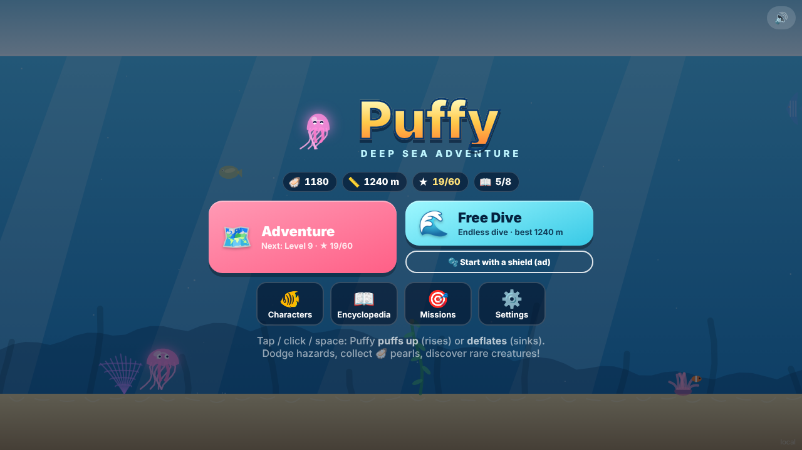

# Puffy: Deep Sea Adventure — Documentation

Puffy is a one-button, hyper-casual web game: a pufferfish dives through four ocean zones, dodging hazards and collecting pearls. It runs in any modern browser with no build step and is packaged for CrazyGames, Poki, YouTube Playables and Facebook Instant Games.

| Document | For | Contents |
|---|---|---|
| [Game Design Document](GAME_DESIGN.md) | Everyone: designers, producers, portal reviewers, testers | Concept, audience, controls, modes, zones and hazards, characters, collections, missions, progression, economy, monetisation, UX, art and audio direction |
| [Technical Guide](TECHNICAL.md) | Developers | Architecture, file map, game loop and state machine, world generation, physics, saving, platform SDK adapters, ads, UI and design system, testing, build and release, how to extend the game |
| [Store listing](../release/STORE_LISTING.md) | Publishing | Title, descriptions, controls and tags for portal forms |
| [Release checklist](../release/CHECKLIST.md) | Publishing | What is done and what is left before a CrazyGames submission |
| [Project README](../README.md) | Quick reference | Feature overview with screenshots and how to run locally |

## At a glance

| | |
|---|---|
| Genre | One-button endless runner / level runner |
| Platforms | Desktop and mobile browsers (landscape) |
| Target portals | CrazyGames (first), Poki, YouTube Playables, Facebook Instant Games |
| Session length | 30 s – 3 min per dive |
| Tech | Vanilla JavaScript (ES modules), HTML5 Canvas 2D, Web Audio API |
| Size | ~80 KB zipped, no asset files (all art and sound are generated in code) |
| Language | English |

